# Enterprise Theme Platform Status Report

**Coverage:** Phase 0 through Phase 6A.1  
**Status:** Architecture hardened; legacy runtime remains authoritative  
**Phase 6B:** Not started  
**Audience:** CTO, architects, investors, senior engineers

## Executive summary

The repository has evolved from a legacy filesystem-oriented theme implementation into a compatibility-preserving enterprise theme platform foundation. The completed work introduces canonical theme entities, immutable artifacts, validation and release governance, deployment records, lifecycle auditability, and a shadow runtime comparison path.

The platform is deliberately not yet using the canonical runtime for customer traffic. This protects production behavior while the new architecture is validated against real legacy responses.

Current architectural maturity is estimated at **68%**. Current production readiness is **72/100** for the migration foundation, but the platform is **not approved for canonical runtime activation**. The difference exists because most control-plane capabilities are present while runtime equivalence, migration baseline reconciliation, package trust, and production rollout evidence remain incomplete.

## 1. What has been implemented

### Phase 0 — migration foundation

- Repository and theme architecture inventory.
- Migration baseline and rollback documentation.
- Structured migration logging.
- Migration feature flags with safe defaults.
- Internal migration health visibility.
- Backward-compatible migration controls.

### Phase 1 — additive canonical database architecture

- Canonical release candidate model.
- Canonical theme family, release, artifact, validation, lifecycle, approval, and deployment entities.
- Additive database migrations.
- Repository and backfill foundations.
- Existing runtime tables and behavior preserved.
- Canonical tables intentionally excluded from legacy runtime resolution.

### Phase 2 — immutable storage artifacts

- Object-storage abstraction.
- Immutable release artifact model.
- SHA-256 integrity verification.
- Streaming artifact uploads.
- Filesystem plus object-storage dual publishing.
- Artifact verification tooling.
- Storage health, metrics, and audit logging.

The filesystem remains the authoritative runtime source.

### Phase 3 — release and validation pipeline

- Release intake and quarantine storage.
- ZIP structure validation.
- Manifest and JSON schema validation.
- Asset, image, font, CSS, reference, and structure validation.
- ZIP bomb and invalid path detection.
- Duplicate release and version compatibility checks.
- Security, compatibility, and performance scoring.
- Validation reports and validation history.
- Preview generation pipeline.
- Approval-ready release model.

### Phase 4 — enterprise lifecycle

- Draft, review, approval, publish, deprecate, archive, and rollback metadata workflows.
- Reviewer assignments and review comments.
- Approval history and release timeline.
- Release comparison, changelog, and release notes.
- Lifecycle permissions and audit events.
- Idempotent transactional actions.
- Optimistic lifecycle revisions.
- Internal lifecycle APIs and UI contracts.

Published release content is treated as immutable.

### Phase 5 — deployment control plane

- Deployment service and contracts.
- Immutable deployment snapshots.
- Append-only deployment history and events.
- Deployment state machine.
- Queue entries, locking, health records, progress events, canary metadata, rollout metadata, and rollback metadata.
- Dependency validation and conflict detection.
- Deployment version graph.
- Deployment idempotency and optimistic sequencing.
- Deployment metrics and audit records.

Phase 5 creates deployment records only. It does not execute deployment or switch storefront resolution.

### Phase 6A — shadow runtime

- Canonical runtime resolver.
- Shadow runtime execution.
- Runtime comparison engine.
- Hash, timing, resource, and compatibility comparison.
- Difference reports for themes, templates, sections, blocks, components, tokens, assets, locales, and configuration.
- Internal health, metrics, and comparison APIs.
- Legacy response preservation.

### Phase 6A.1 — hardening

- Sampling, bounded concurrency, queue capacity, timeout, cancellation, and circuit breaker.
- Atomic conditional optimistic locking.
- Database-level immutability triggers.
- Fresh-database migration verification and drift detection.
- CI migration validation workflow.
- Enterprise audit envelope with shared schema.
- Report redaction, byte limits, retention, and cursor pagination.
- Central metrics abstraction with counters, histograms, error rates, and Prometheus formatting.

## 2. Business problems solved

The migration addresses the major business risks of a theme platform operating at enterprise scale:

- Theme changes can now be governed through review and approval rather than direct mutable production state.
- Releases can be validated before publication.
- Theme packages have immutable identity and integrity verification.
- Deployment intent is auditable and idempotent.
- Rollback metadata and deployment history provide operational recovery context.
- The platform can compare the future runtime with the existing customer-visible runtime without exposing unverified output.
- Storage can evolve from local filesystem dependency toward object storage without forcing an immediate runtime cutover.
- Multi-tenant and multi-channel scope is represented in canonical entities and deployment records.

## 3. Technical problems solved

- Unstructured theme state has been supplemented with canonical entities.
- Mutable release behavior has been separated from immutable package identity.
- ZIPs now have a quarantine and validation boundary.
- Storage integrity is verified with SHA-256 hashes.
- Lifecycle and deployment operations are transactional and idempotent.
- Concurrent lifecycle writers are rejected through atomic revision checks.
- Published release and deployment snapshot mutation is blocked at database level.
- Shadow work is prevented from creating unbounded production load.
- Runtime comparison data is bounded, redacted, retained, and paginated.
- Operational and audit observability has a shared direction.

## 4. Architecture before and after

### Before

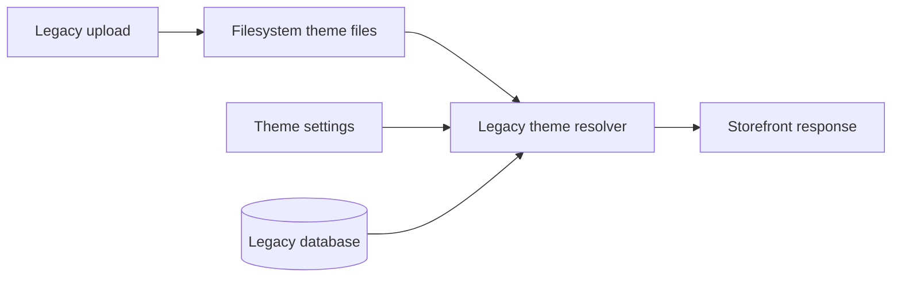

### After

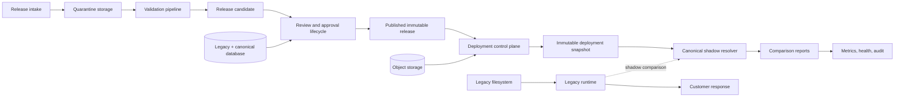

The critical safety property is that the customer response still comes only from `Legacy`.

## 5. Database evolution

Database evolution is additive and phased:

1. Existing theme tables remain intact.
2. Canonical release and artifact records are added alongside legacy data.
3. Validation, lifecycle, approval, and audit history are persisted separately.
4. Deployment snapshots and append-only events are introduced.
5. Runtime comparison reports are added without becoming runtime inputs.
6. Database triggers protect published content and append-only deployment records.
7. Backfill tooling establishes canonical records without changing runtime ownership.

The database now acts as a control-plane system of record for releases, validation, lifecycle, deployment intent, and comparison evidence. The filesystem remains the runtime authority until a future approved migration phase.

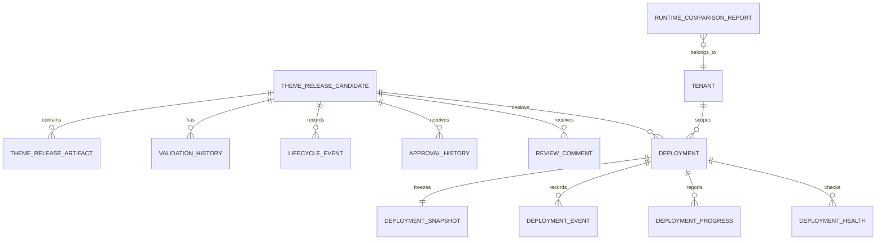

## 6. Theme lifecycle

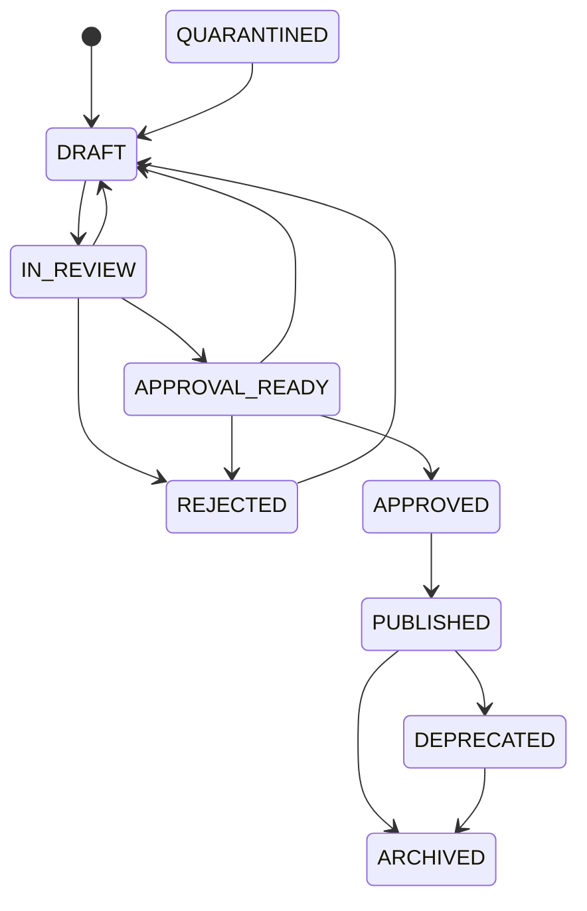

Every lifecycle action creates history and audit data. Draft metadata may change; published package identity and validated content may not.

## 7. Deployment lifecycle

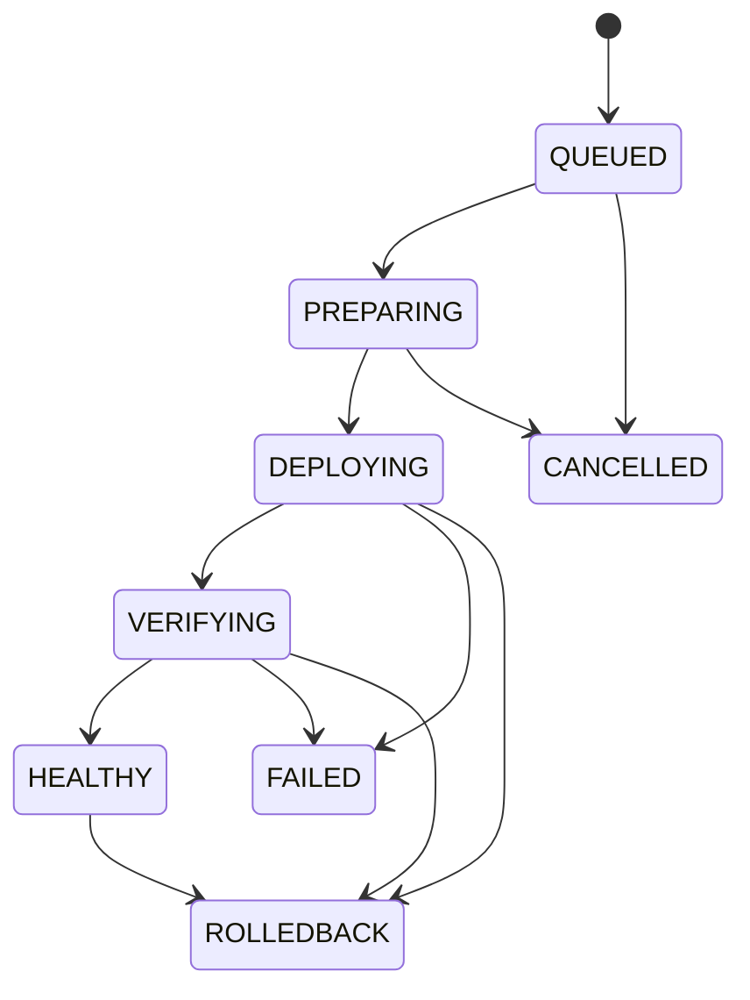

Phase 5 records these states and their immutable history. It does not yet perform runtime deployment.

## 8. Runtime architecture

The current public runtime remains:

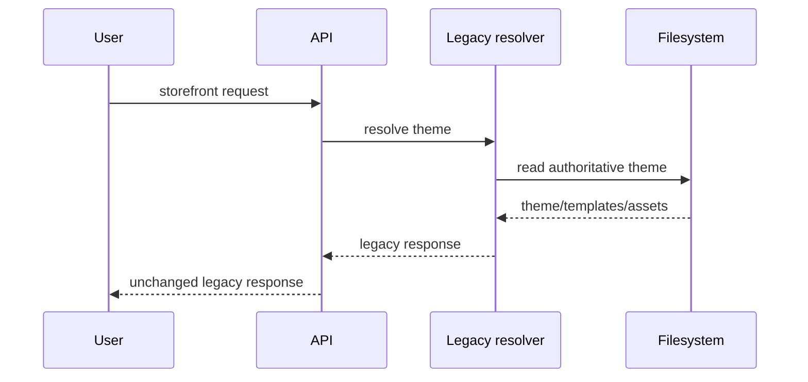

Canonical tables, deployment snapshots, object storage, and comparison reports are not runtime inputs.

## 9. Shadow runtime architecture

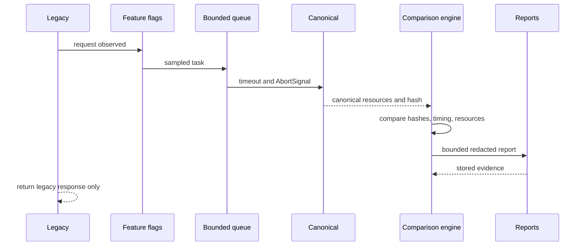

Even with runtime flags enabled, canonical output cannot replace the legacy response.

## 10. Security improvements

- Quarantine boundary before release acceptance.
- ZIP bomb and path traversal detection.
- Manifest, JSON, asset, CSS, font, image, and reference validation.
- SHA-256 package integrity checks.
- Immutable published release protection.
- Append-only deployment record protection.
- Permission checks for review, approval, publishing, and deployment actions.
- Internal-only lifecycle, deployment, and comparison endpoints.
- Sensitive comparison values redacted before persistence.
- Audit envelope with correlation and request identifiers.

Remaining security work includes package signing, signature trust roots, malware scanning, dependency policy enforcement, and formal threat-model validation.

## 11. Performance improvements

- Streaming artifact upload support.
- Object-storage abstraction for large packages.
- Bounded shadow concurrency.
- Queue capacity protection.
- Timeout and cancellation of slow comparisons.
- Circuit breaker for repeated canonical failures.
- Indexed report scope and creation time.
- Cursor-based report pagination.
- Report byte limits and retention cleanup.
- Central histograms for runtime duration and error analysis.

The legacy request path remains free of canonical response latency because shadow work is asynchronous.

## 12. Scalability improvements

- Immutable artifacts can be replicated through object storage.
- Deployment records are tenant/channel/environment scoped.
- Distributed deployment locking prevents duplicate active deployment intent.
- Append-only histories support partitioning and archival.
- Queue and concurrency controls prevent shadow traffic amplification.
- Canonical database entities allow future service separation.
- Centralized metrics provide a path to fleet-wide aggregation.

The next scalability step is a production queue/worker topology with durable distributed scheduling and external metrics storage.

## 13. Observability improvements

Current observability includes:

- Migration health and structured migration logs.
- Storage health and artifact metrics.
- Release validation reports and history.
- Lifecycle and deployment metrics.
- Deployment timelines, health records, and progress events.
- Runtime comparison reports.
- Runtime health and Prometheus-formatted metrics.
- Enterprise audit envelope with schema version, actor, tenant, request, correlation, resource, action, outcome, and metadata.

The metrics abstraction is centralized, but production exporter activation remains future work.

## 14. Migration safety improvements

- Additive schema changes.
- Explicit phase boundaries.
- Backfill tooling separated from runtime behavior.
- Feature flags disabled by default.
- Migration health endpoint.
- Fresh-database verification tooling.
- Applied/source migration drift detection.
- CI migration validation workflow.
- Reversible immutability migration verified through apply, rollback, and reapply.

Current blocker: the existing database contains two migration records not present in the current source baseline. This must be reconciled before claiming full migration reproducibility.

## 15. Rollback strategy

### Application rollback

Disable shadow and canonical feature flags. The legacy runtime remains the response authority.

### Data rollback

Use migration-specific rollback only for additive infrastructure where safe. Published releases, snapshots, lifecycle events, deployment events, and audit history should not be destructively rewritten in production.

### Release rollback

Phase 4 stores rollback metadata. Phase 5 stores deployment rollback metadata and state. Actual artifact restoration and runtime switching are intentionally deferred.

## 16. Feature flag strategy

Flags separate observation from activation:

- Migration diagnostics and rollout controls.
- Artifact/object-storage behavior.
- Release validation and lifecycle workflows.
- Deployment engine records.
- Runtime shadow execution.
- Runtime comparison persistence.
- Runtime metrics and health.

All new runtime behavior is disabled by default. Runtime shadow flags cannot change the public response source.

## 17. Current project maturity

### Maturity estimate: 68%

This estimate reflects:

- 90% control-plane foundation.
- 85% release governance and validation.
- 80% deployment metadata and safety controls.
- 65% observability and operational readiness.
- 35% canonical runtime equivalence.
- 20% production runtime migration and rollback execution.

The platform is mature as a migration and governance foundation, but not yet mature as a fully active canonical runtime platform.

## 18. Remaining phases

### Phase 6B — future, not started

Runtime activation preparation and controlled runtime migration. It must not begin until the remaining blockers are closed and separately approved.

### Later enterprise phases

- Controlled canary runtime activation.
- Runtime switching with instant legacy fallback.
- CDN and edge deployment activation.
- Actual deployment workers.
- Automated rollback execution.
- Marketplace and distributor workflows.
- Theme builder and visual editing platform.
- Full mobile theme runtime adoption.
- Enterprise localization expansion.
- Package signing and trust management.
- Multi-region disaster recovery and operational certification.

## 19. Remaining risks

| Risk | Severity | Current control | Required action |
|---|---:|---|---|
| Canonical runtime differs from legacy behavior | Critical | Shadow comparison | Build golden corpus and close differences |
| Migration baseline drift | High | Drift verifier | Reconcile two historical migration records |
| Package tampering or malicious content | High | Hash and validation | Add signing and malware scanning |
| Shadow workload growth | Medium | Sampling, queue, circuit breaker | Validate limits under production load |
| Incomplete exporter integration | Medium | Metrics abstraction | Connect OpenTelemetry/Prometheus backend |
| Deployment executor absent | High | Immutable deployment records | Implement only after runtime activation approval |
| Incomplete rollback execution | High | Rollback metadata | Build and test artifact/runtime restoration |
| Historical audit fragmentation | Medium | New audit envelope | Migrate or bridge legacy event schemas |

## 20. Production readiness score

**72/100 for the migration foundation.**

Suggested interpretation:

- 90–100: production canonical runtime ready.
- 75–89: controlled pre-production or limited internal pilot.
- 60–74: hardened migration foundation; not runtime activation ready.
- Below 60: architecture or safety controls incomplete.

The current platform is at the upper end of the hardened-foundation stage.

## 21. Estimated work remaining

Approximately **30–40% of the total enterprise platform program** remains. The highest-effort work is not additional CRUD functionality; it is proving runtime equivalence and operating the platform safely at scale.

Indicative remaining effort:

- Migration drift reconciliation and operational certification: 1–2 weeks.
- Golden corpus, runtime equivalence, and performance validation: 4–8 weeks.
- Package signing, malware scanning, and trust policy: 2–4 weeks.
- Production metrics/exporter and alerting integration: 1–3 weeks.
- Controlled activation preparation and canary design: 3–6 weeks.
- Deployment execution and rollback automation: 6–12 weeks.

These are planning ranges, not commitments.

## 22–26. Architecture diagrams

### Enterprise architecture

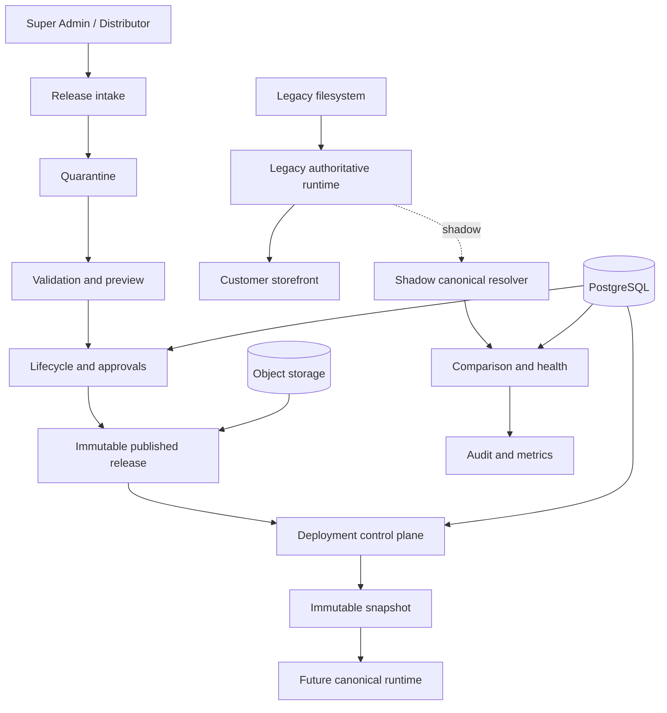

### Database architecture

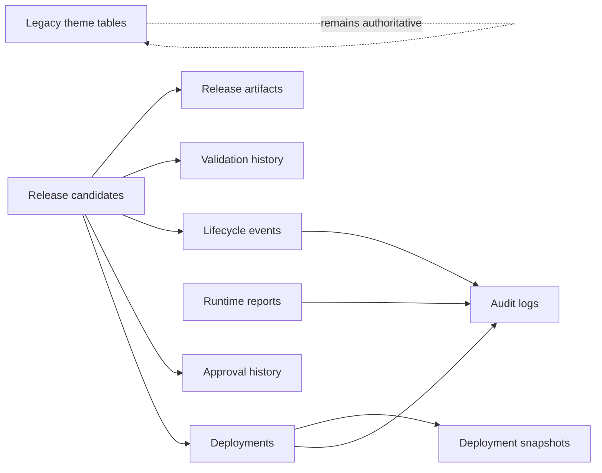

### Theme lifecycle

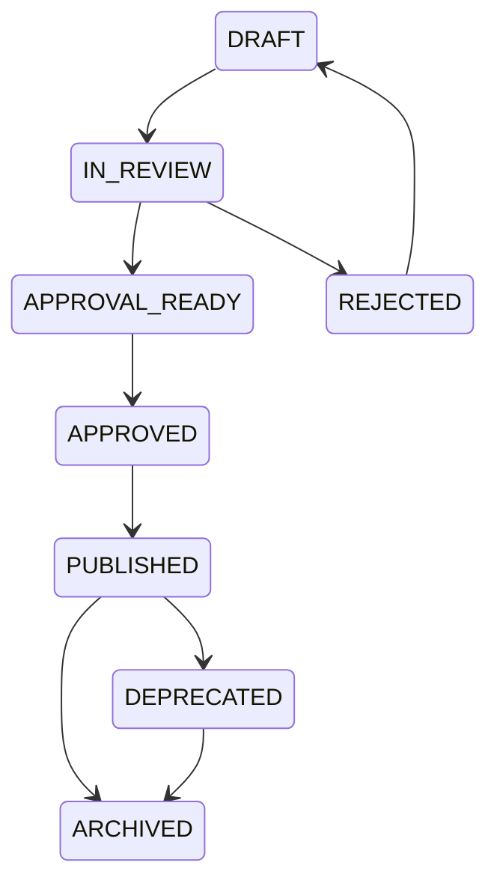

### Deployment lifecycle

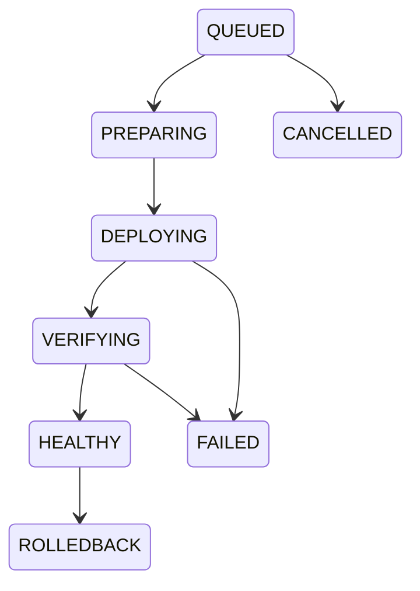

### Runtime flow

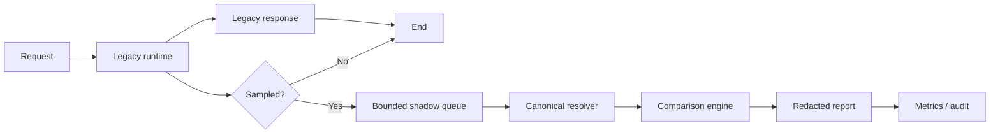

## 27. Final roadmap to production

1. Reconcile migration drift and establish a signed migration baseline.
2. Complete package signing, trust validation, malware scanning, and dependency policy.
3. Build a representative golden theme corpus across web, mobile, locales, assets, templates, and components.
4. Compare legacy and canonical output until all critical differences are explained or resolved.
5. Load-test shadow queue, timeout, circuit-breaker, report storage, and retention behavior.
6. Connect production metrics exporters, dashboards, alerts, tracing, and on-call runbooks.
7. Complete threat modeling, penetration testing, tenant isolation testing, and audit review.
8. Implement and test deployment workers in a non-production environment.
9. Implement artifact restoration and automated rollback without changing public runtime behavior.
10. Design a canary activation plan with explicit legacy fallback.
11. Obtain architecture, security, operations, and business approval for Phase 6B.
12. Activate canonical runtime only for internal tenants or controlled canaries.
13. Expand gradually using error budgets, comparison thresholds, and automated rollback criteria.
14. Declare production migration complete only after sustained equivalence, performance, and recovery evidence.

## Final conclusion

The project has successfully established the enterprise control plane and a safety-oriented migration path. Its strongest characteristic is operational conservatism: new release, artifact, lifecycle, deployment, and canonical-runtime systems exist without taking authority away from the legacy runtime.

The next milestone is not adding more platform surface area. It is proving correctness, reconciling migration history, completing package trust, and demonstrating that the canonical runtime can be activated and reversed safely under real production conditions.
