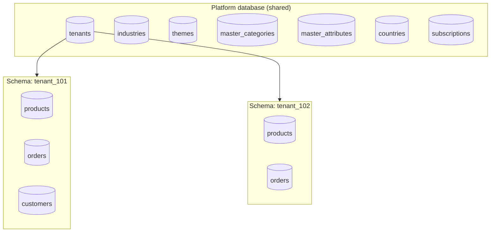
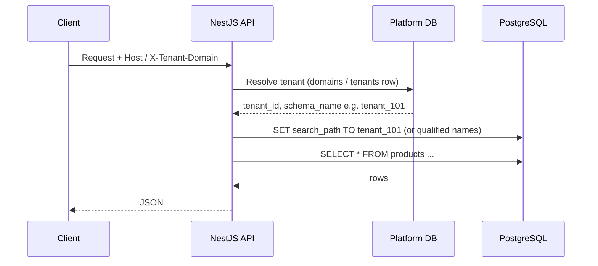
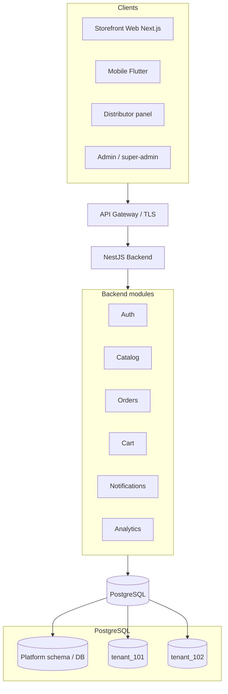

# SaaS platform database architecture (platform DB + tenant schemas)

This document is the **target architecture** for scaling the monorepo to **Shopify-style multi-tenancy**: one shared **platform** PostgreSQL database for global SaaS data, and **one schema per tenant** for isolated ecommerce data.

The current codebase may still use a **single schema with `tenant_id`** on rows. Migrating to schema-per-tenant is a **planned refactor**; use this doc as the north star for migrations, NestJS connection handling, and ops.

---

## 1. Two database layers

| Layer | Purpose | Example name |
|--------|---------|----------------|
| **Platform (shared)** | Registry, billing, themes, master catalog templates, countries, languages | `saas_platform_db` |
| **Tenant (isolated)** | Per-store products, orders, carts, customers, inventory | `tenant_101`, `tenant_102`, … |



---

## 2. Platform database — typical tables

- **Tenancy & billing:** `tenants`, `subscriptions`, `plans`, `plan_features` (as applicable)
- **Global templates:** `industries`, `master_categories`, `master_attributes`, `master_attribute_values`
- **Themes:** `themes`, `theme_combo_mapping`, `tenant_theme_settings` (assignment lives on platform side; theme **files** stay in object storage / `storage/`)
- **Geo / i18n:** `countries`, `languages`
- **Control:** `system_settings`, audit metadata as needed

These tables are **shared across all tenants** and are queried **without** switching tenant schema.

---

## 3. Tenant schema — typical tables (per `tenant_<id>`)

Each tenant gets a dedicated PostgreSQL **schema** (not a separate database server unless you promote a tenant later).

**Commerce core**

- `customers`, `customer_addresses`
- `products`, `product_variants`, `product_images`, `product_attributes`, `product_categories` (junction)
- `warehouses`, `inventory`

**Cart & checkout**

- `carts`, `cart_items`

**Orders & money**

- `orders`, `order_items`, `payments`, `invoices`

**Growth**

- `coupons`, `coupon_usage`

**Comms & observability**

- `notifications`, `notification_logs`
- `analytics_events`, `api_logs` (optional)

**Store builder / media**

- `tenant_media`, `tenant_sections` (or equivalent CMS tables)

**Tenant-specific catalog extensions (optional)**

- `tenant_categories`, `tenant_attributes`, `tenant_attribute_values`  
  Master rows stay on **platform**; tenant-specific rows live in the **tenant schema**.

---

## 4. Why schema per tenant

| Benefit | Meaning |
|---------|--------|
| **Isolation** | No cross-tenant row leaks if queries run in the correct schema |
| **Customization** | Extra columns or tables for one client without touching others |
| **Migration** | `tenant_101` can be dumped and moved to a dedicated DB/instance |
| **Security** | Access control can be schema-scoped (roles, `search_path`) |
| **Scale story** | Shard by tenant schema or move hot tenants to their own cluster |

---

## 5. Rule: `tenant_id` inside tenant tables

Inside `tenant_101.products`, a **`tenant_id` column is usually redundant** because the schema name already implies the tenant. Some teams still keep a **generated/stored** `tenant_id` for easier joins in analytics exports—this is optional.

---

## 6. Category & attribute merge (API behaviour)

**Response model (conceptual):**

```text
visible_categories = master_categories (scoped by industry / template)
                  ∪ tenant_categories (from tenant schema)
```

Same idea for attributes:

```text
visible_attributes = master_attributes ∪ tenant_attributes
```

Merge rules (ordering, deduplication, overrides) should be explicit in product APIs.

---

## 7. Request flow (host → tenant → schema)



Resolution sources can include: **Host**, **`X-Tenant-Id`**, **`X-Tenant-Domain`**, custom domain rows on platform DB.

---

## 8. NestJS implementation options

1. **`SET search_path`** per request (connection-bound): simple, but pool care is required (reset `search_path` when releasing connections).
2. **Qualified identifiers:** `tenant_101.products` built from resolved schema name (no `search_path` mutation).
3. **Separate TypeORM DataSource / connection** per tenant: heaviest; use only if you need hard isolation at the pool level.

Tenant creation flow (target):

1. Insert row in platform `tenants`
2. `CREATE SCHEMA IF NOT EXISTS tenant_<id>`
3. Run **tenant migrations** into that schema (`npm run migration:tenant` style)
4. Persist `schema_name` on the tenant record (or derive deterministically from `tenant_id`)

---

## 9. High-level SaaS system diagram (apps → API → data)



---

## 10. Theme, catalog, order — logical flows (text)

**Theme**

```text
Admin uploads theme → platform themes + storage path → tenant_theme_settings → storefront GET theme manifest → template renderer
```

**Catalog (distributor)**

```text
Add product → products → variants → attributes → images → inventory / warehouses
```

**Order**

```text
Product page → cart / cart_items → checkout → orders / order_items → payments → invoices
```

---

## 11. Migration strategy (split)

| Command area | What runs |
|--------------|-----------|
| **Platform** | `npm run migration:run` (global DDL: tenants, themes, master_* …) |
| **Tenant** | `npm run migration:tenant` (per schema: products, orders, …) |

New tenant onboarding = platform row + `CREATE SCHEMA` + tenant migration version table inside that schema.

---

## 12. Scaling checklist (later)

- API: horizontal scale behind load balancer
- DB: read replicas, connection pooling (PgBouncer)
- Cache: Redis for sessions, rate limits, BullMQ
- Search: Meilisearch / OpenSearch for product search
- CDN: theme assets + media URLs

---

## 13. Relation to this repo today

The backend currently uses a **single database** with **`tenant_id` on many tables**. Moving to **schema-per-tenant** is a **large, deliberate migration**: new connection strategy, tenant DDL runner, and data backfill or export/import per tenant.

This file does **not** change runtime behaviour by itself; it is the **agreed architecture** for the next implementation phase.
