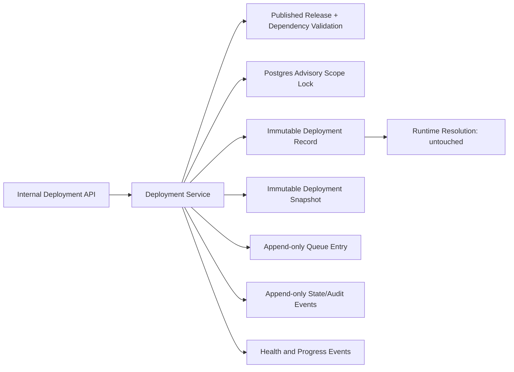
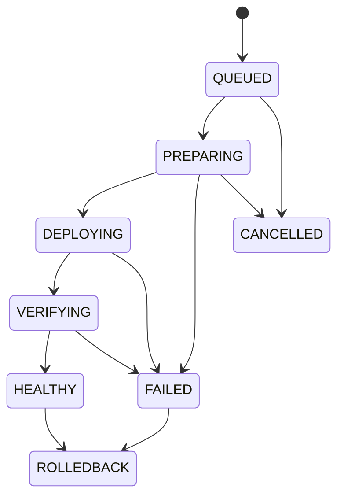

# Phase 5 Enterprise Theme Deployment Engine

Phase 5 creates deployment records only. It does not execute deployment, switch runtime resolution, activate a CDN, or change storefront rendering.

## Architecture

## State machine

## Transaction flow

Queueing obtains a PostgreSQL transaction-scoped advisory lock for `tenant + channel + environment`, checks the unique active lock row, validates that the release is published, validates dependencies and channel compatibility, and inserts the deployment, snapshot, initial event, queue entry, and lock in one transaction.

State changes obtain the same scope lock, read the latest event sequence, require the caller's expected sequence, validate the state transition, append one event, and renew or release the scope lock. Duplicate idempotency keys return the existing projection without creating another event.

## Immutability and safety

- Deployment roots, snapshots, queue entries, state events, health checks, and progress events are insert-only.
- The deployment root stores no mutable current state; current state is projected from the latest event.
- Only published release candidates can be queued.
- Active scope uniqueness is enforced both by advisory locking and a database unique constraint.
- Foreign keys prevent orphan snapshots/events and restrict deletion of referenced releases.
- Runtime activation and deployment execution are intentionally absent.

## Feature flags

- `THEME_DEPLOYMENT_ENGINE_ENABLED` gates all service operations and APIs.
- `THEME_DEPLOYMENT_METRICS_ENABLED` gates metric collection and output.
- Both default to disabled.
