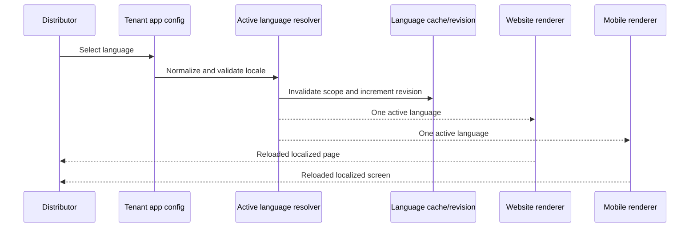

# Theme Language Consistency Layer

## Scope

This layer provides one normalized active language for distributor state, website rendering, mobile preview propagation, and theme preview state. It is feature-flagged and does not activate the canonical runtime.



## Guarantees

- Language codes are normalized to supported base locales.
- Invalid languages resolve to a safe default.
- Tenant language changes invalidate the language cache immediately.
- Preview language changes update the renderer URL and force a reload.
- RTL direction is derived from the active locale.
- Currency, number, and date formatting use the active locale.
- Validation detects missing values and source-language duplicates in non-default dictionaries.
- Publish is blocked when consistency is enabled and coverage is not ready.

## Translation Coverage Report

The report is embedded in the release validation report under `translationCoverage`:

```json
{
  "schemaVersion": 1,
  "activeLanguage": "ar",
  "requiredLanguages": ["en", "ar"],
  "totalKeys": 200,
  "translatedKeys": 198,
  "completeness": 99,
  "missing": [{ "language": "ar", "key": "checkout.submit" }],
  "mixedLanguageCandidates": [],
  "readyForPublish": false
}
```

## Language Consistency Report

Internal preview diagnostics report the active language, direction, missing translation candidates, fallback count, and completeness. These diagnostics are not exposed to storefront users.

## Publish blocking

When `THEME_LANGUAGE_CONSISTENCY_ENABLED=true` and `THEME_LANGUAGE_PUBLISH_BLOCKING=true`, an approved release cannot transition to `PUBLISHED` unless `translationCoverage.readyForPublish=true`.

Both flags default to safe, non-invasive values. Existing production behavior is unchanged while the consistency layer is disabled.

## Cache and reload behavior

Tenant language changes increment a tenant-scoped revision and clear cached language state. Preview changes use a cache-busting nonce and reload the real renderer, preventing stale language, direction, or formatting state.

## Mobile boundary

The mobile application must expose a real preview renderer that consumes `previewLanguage`. The platform propagates and validates the contract; a renderer that ignores it is an integration inconsistency, not a successful preview.
