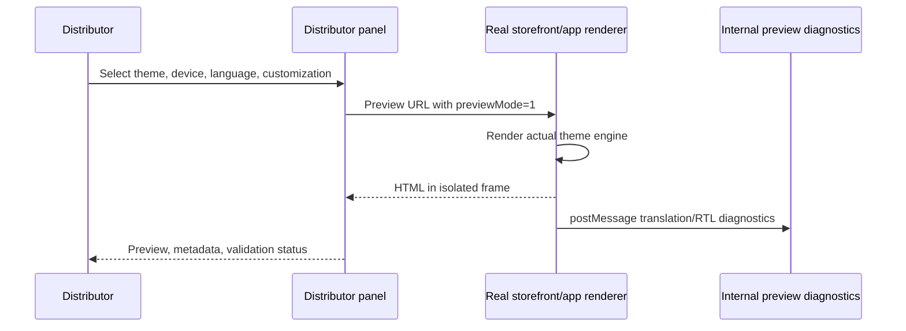
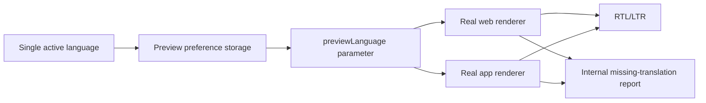

# Theme Preview Experience

## Safety boundary

The distributor preview is isolated behind `VITE_THEME_PREVIEW_ENABLED`. It uses a real configured renderer in an iframe and passes preview-only query parameters. The storefront accepts those parameters only when `NEXT_PUBLIC_THEME_PREVIEW_ENABLED` is enabled (or in development). Live storefront requests do not receive preview overrides.

## Web experience

- Desktop, tablet, and mobile viewport controls.
- Zoom control and refresh.
- Skeleton loading while the real renderer loads.
- Preview watermark.
- Theme metadata, author, version, compatibility, description, and screenshot.
- External preview URL.
- Live language and token customization through URL-scoped preview state.

## App experience

The panel supports an Android/iPhone frame surface and screen selection for home, category, product, cart, checkout, and account. It requires a configured real mobile preview renderer through `mobilePreviewUrl` or `VITE_MOBILE_PREVIEW_URL`. If absent, the panel explicitly reports that the renderer is unavailable; it does not use static screenshots or fabricated screens.

## Language architecture

The selected language is persisted per theme in distributor-panel storage and is sent to both preview surfaces as `previewLanguage`. The renderer applies the active language, direction, and existing locale formatting behavior. It reports missing translation candidates through an internal `postMessage` diagnostic. No fallback report is exposed to storefront users.

## Customization architecture

Current preview controls send primary color, secondary color, font family, and border radius as preview-only token parameters. The values are not persisted to production theme settings and do not affect publish or runtime resolution.

The control surface is intentionally additive. Header, footer, menu, sections, widgets, logo, favicon, banner, button, and icon editing should be connected to the theme manifest schema in the next preview-builder increment rather than represented by fake controls.

## Accuracy contract

The web preview is accurate only when a real renderer URL is configured. Preview screenshots are metadata, not the rendering source. The platform reports an unavailable renderer instead of claiming accuracy when one is not configured.

## Feature flags

- `VITE_THEME_PREVIEW_ENABLED`: enables the distributor panel experience.
- `NEXT_PUBLIC_THEME_PREVIEW_ENABLED`: permits preview-only query overrides in the storefront renderer.
- Existing production runtime and canonical-runtime flags are unchanged.

## Validation coverage

Implemented in this phase:

- Renderer availability detection.
- Skeleton/loading state.
- Active-language propagation.
- RTL direction diagnostics.
- Missing translation diagnostics from the real web renderer.
- Preview-only customization propagation.
- Isolation from live runtime settings.

Asset, font, icon, overflow, and full translation completeness validation should consume the release validation pipeline and renderer diagnostics in a subsequent increment.
