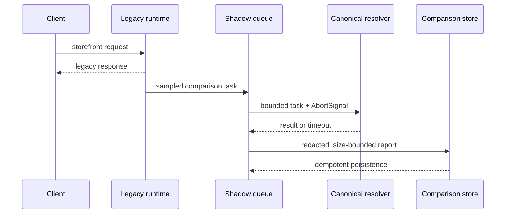

# Theme Runtime Phase 6A.1 Hardening

## Scope

This phase hardens shadow execution and migration safety. The legacy runtime remains authoritative for every public response. Canonical execution is asynchronous, internal, sampled, bounded, cancellable, and never selected as a response source.

## Hardening controls

- Sampling, bounded concurrency, bounded queue capacity, timeout cancellation, and a resettable circuit breaker are configurable under `themeRuntimeShadow` and default to non-invasive behavior.
- Lifecycle revisions use conditional updates and verify `affected === 1`; stale writers receive a conflict.
- Published release content and deployment snapshots/events/progress are protected by PostgreSQL triggers.
- Migration verification checks source duplicates, applied/source drift, pending migrations, and an optional empty-database run. CI invokes it against PostgreSQL.
- Audit writes use the versioned enterprise envelope and can share the caller's transaction manager.
- Reports are recursively redacted, size bounded, retained by age, and available through cursor pagination while the legacy report endpoint remains unchanged.
- Metrics are exposed through a central counter/histogram abstraction with Prometheus text output. No production exporter or runtime switch is activated by this phase.

## Readiness

The architecture freeze baseline was 58/100. After this phase, the hardening score is **72/100**. This is not a runtime-activation approval.

Remaining blockers are canonical runtime fidelity, migration baseline reconciliation, package signing and malware scanning, a production OpenTelemetry/Prometheus exporter, golden-response coverage, and deployment execution/rollback. These belong to later phases or release preparation and remain intentionally inactive.
