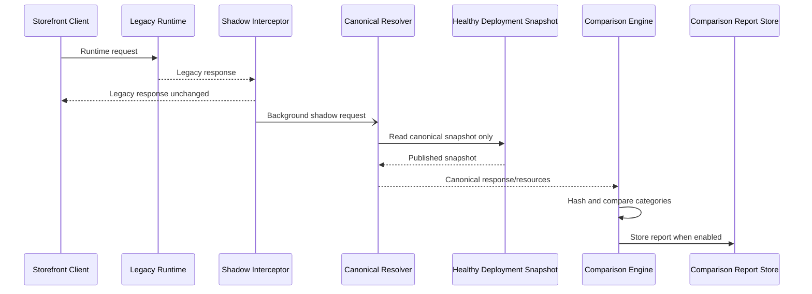
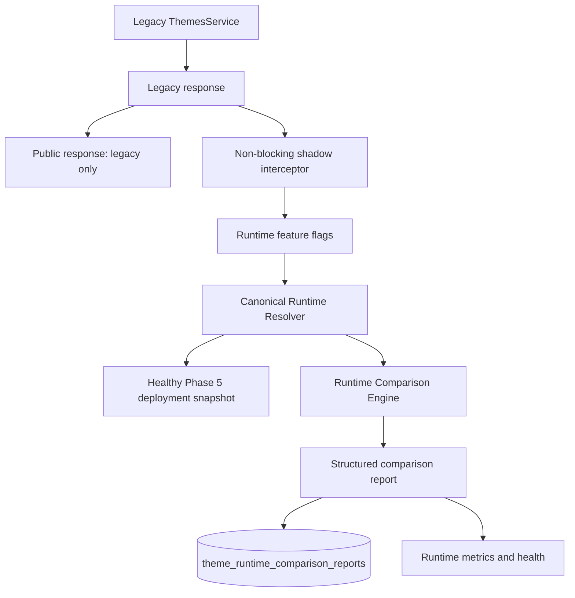

# Phase 6A Runtime Shadow Architecture

Phase 6A observes canonical runtime behavior without allowing canonical output to reach users. All flags default to disabled.

## Request sequence



## Architecture



## Comparison report format

```json
{
  "schemaVersion": 1,
  "requestId": "request-id",
  "tenantId": "tenant-id",
  "channel": "WEB",
  "status": "DIFFERENT",
  "legacyResponseHash": "sha256",
  "canonicalResponseHash": "sha256",
  "legacyDurationMs": 12,
  "canonicalDurationMs": 7,
  "added": [],
  "removed": [],
  "changed": [],
  "missing": [],
  "compatibilityWarnings": [],
  "generatedAt": "ISO-8601 timestamp"
}
```

Each difference includes a category (`theme`, `templates`, `sections`, `blocks`, `components`, `tokens`, `assets`, `locales`, or `runtimeConfiguration`), a relative path, and the applicable legacy/canonical value.

## Safety decisions

- The interceptor uses `tap`; it does not replace or transform the observable response.
- Shadow failures are caught and logged/metric-counted without affecting the request.
- Canonical resolution reads only healthy deployment snapshots, never legacy selection tables.
- Canonical runtime flags, report storage, metrics, and health are independently disabled by default.
- Runtime response hashes are diagnostic only; they never determine response selection.
