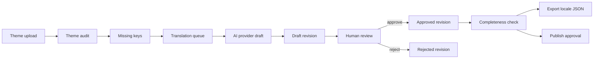

# Enterprise Translation Pipeline

## Scope

The translation pipeline is isolated from storefront runtime resolution, language resolution, theme rendering, and published locale delivery. It creates and manages translation drafts; it does not write approved locale files into runtime storage.

## Workflow

## Data guarantees

- AI output is always stored as `DRAFT`.
- Approved values cannot be overwritten through review or import APIs.
- Every draft, review, rejection, import, and publish action creates a history revision and audit event.
- Optimistic locking protects concurrent entry edits.
- Publishing is blocked until every job entry has an approved value.
- Locale export includes approved values only.
- Import creates drafts and never silently approves content.

## Feature flags

All operational behavior is disabled unless explicitly enabled:

- `TRANSLATION_PIPELINE_ENABLED`
- `TRANSLATION_AI_DRAFTS_ENABLED`
- `TRANSLATION_REVIEW_ENABLED`
- `TRANSLATION_QUEUE_ENABLED`
- `TRANSLATION_AI_PROVIDER=openai`

If the pipeline is disabled, pipeline APIs reject requests and no queue worker is started. No storefront module imports this subsystem.

## API surface

- `POST /api/v1/translation-pipeline/jobs`
- `GET /api/v1/translation-pipeline/jobs`
- `GET /api/v1/translation-pipeline/jobs/:id`
- `POST /api/v1/translation-pipeline/entries/:id/review`
- `POST /api/v1/translation-pipeline/entries/bulk-review`
- `POST /api/v1/translation-pipeline/jobs/:id/import`
- `GET /api/v1/translation-pipeline/jobs/:id/export`
- `GET /api/v1/translation-pipeline/entries/:id/history`
- `POST /api/v1/translation-pipeline/jobs/:id/publish`
- `GET /api/v1/translation-pipeline/metrics`

## Review UI

The admin route `/themes/translations` provides job selection, coverage, missing-entry filtering, source/draft comparison, review actions, and publish readiness. It is separate from storefront preview and runtime rendering.

## Storage

The migration adds append-oriented job, entry, revision, and audit-event tables. Existing `translations` behavior is unchanged for backward compatibility.
