# Flutter B2B Commerce Blueprint

Audit date: 2026-08-24  
Scope: `saas-platform/tenant-apps/mobile-app` Flutter app, with integration context from `backend/src` and `admin/src`.  
Rule followed: analysis/documentation only. No application code was modified.

## Executive Summary

This is a tenant-aware B2B commerce mobile storefront built in Flutter. It serves retailer/customer procurement against a distributor or tenant backend. The app supports mobile OTP login, dynamic tenant configuration, theme-driven home layouts, multilingual content, product/category browsing, authenticated and guest cart, checkout, orders, reorder, wishlist, credit visibility, profile, address book, notifications, support tickets, and preference settings.

The project is not yet a complete enterprise B2B procurement product. Strong foundations exist in the backend for pricing, GST/MOQ, invoices, tenant admin, catalog management, coupons, WhatsApp, notifications, and build/theme management, but the Flutter app exposes only part of that surface. The largest mobile gaps are GST verification, RFQ/quote workflows, tier/quantity pricing display, payment gateway selection, invoice download, returns, order tracking detail, vendor/warehouse flows, and admin mobile workflows.

Overall implementation score: 68/100  
Commerce readiness: 62/100  
Enterprise B2B readiness: 49/100  
UI consistency: 72/100  
Security posture: 56/100  
Performance posture: 70/100

## Source Inventory

| Area | Observed |
|---|---:|
| Flutter Dart files under `lib` | 69 |
| Flutter tests under `test` | 8 |
| Packaged asset files | 22 |
| Main app root | `lib/main.dart`, `lib/app.dart`, `lib/mobile_app_entry.dart` |
| State management | `flutter_riverpod` providers, state providers, future providers, state notifiers |
| HTTP client | `dio` through `apiClientProvider` |
| Local persistence | `shared_preferences` |
| Localization | Flutter localizations plus JSON dictionaries in `assets/locales/storefront` |
| Images | Demo product PNGs, login hero, home banner |
| Fonts | Roboto regular, medium, bold, italic |
| Backend source scanned for integration context | NestJS modules in `backend/src` |
| Admin source scanned for connection context | React admin pages in `admin/src` |

## 1. Project Overview

### What The Application Is

The app is a B2B storefront for a distributor/tenant. Customers can browse catalog items, add products to cart, place orders after OTP login, review past orders, reorder previous purchases, view credit, and manage account/address/settings.

### Business Model

The business model is multi-tenant SaaS commerce:

| Actor | Role |
|---|---|
| Platform owner | Hosts the SaaS system, admin portal, build system, tenant provisioning, billing, themes, and integrations. |
| Distributor/Tenant | Owns catalog, pricing, customer accounts, credit, orders, app branding, and storefront settings. |
| Buyer/Retailer | Uses mobile app to browse, order, reorder, manage account and delivery details. |
| Admin/Staff | Uses web admin/distributor tools, not this Flutter app, for product/order/customer/theme management. |

### Target Users

Primary users are B2B buyers such as retailers, dealers, procurement users, shop owners, and repeat business purchasers. Secondary stakeholders are distributor sales teams and tenant admins, but their workflows are mostly in the web admin/backend, not the mobile app.

### Buyer Journey

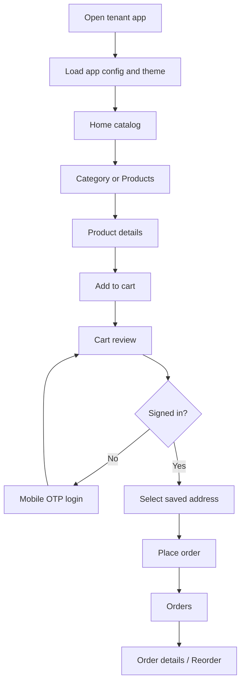

### Seller/Admin Workflow

The Flutter app does not implement seller/admin screens. Integration context shows backend/admin modules for tenants, products, categories, attributes, catalog pricing, orders, support, coupons, themes, notifications, builds, WhatsApp, billing, analytics, and settings. Mobile consumes configured outputs such as `/storefront/app-config`, `/storefront/theme`, `/storefront/products`, categories, cart, orders, profile, support, and notifications.

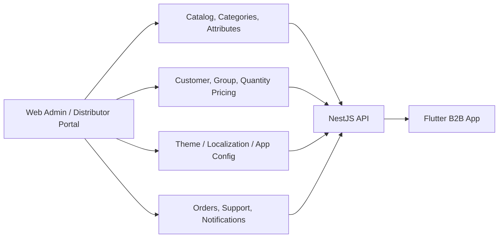

### Technology Stack

| Layer | Technology |
|---|---|
| Mobile | Flutter SDK 3.5 range, Material 3 |
| State | Riverpod 2.6 |
| API | Dio |
| Persistence | SharedPreferences |
| Localization | `flutter_localizations`, `intl`, bundled JSON dictionaries |
| Media | `image_picker`, `flutter_svg`, network/asset image widgets |
| Backend | NestJS/TypeScript, JWT, tenant middleware, modules for commerce/admin |
| Admin | React/Vite web admin |

### Flutter Architecture

The app uses feature folders with a thin shared/core layer:

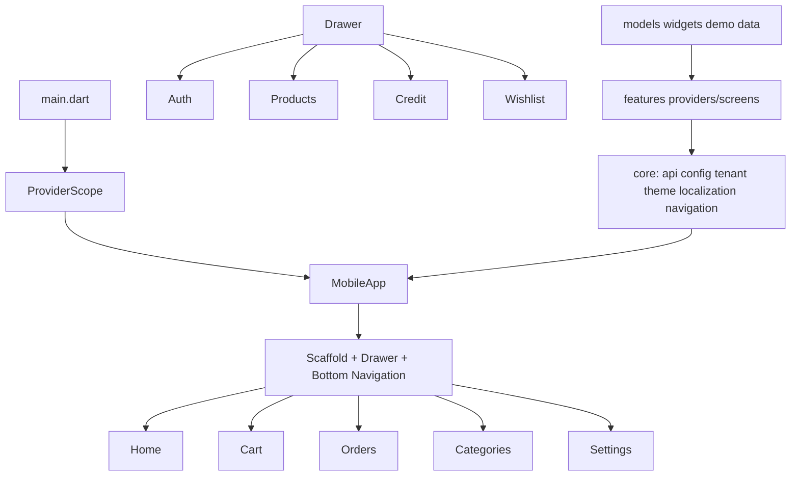

### Folder Structure

```text
lib/
  app.dart                         Main app shell, themes, tabs, drawer
  main.dart                        SharedPreferences/bootstrap entry
  mobile_app_entry.dart            Alternate mobile entry with config states
  core/
    api/                           Dio client, token provider, error helpers
    config/                        build config, app config, user settings
    device/                        storefront device id
    layout/                        responsive helpers
    localization/                  app language contract and translation
    logging/                       UI/provider error logging
    navigation/                    selected tab state
    tenant/                        tenant registry
    theme/                         theme fetch/model/render/component registry
  features/
    auth/                          OTP login and auth provider
    cart/                          cart UI, totals, checkout
    categories/                    category browsing
    credit/                        customer credit view
    home/                          grid/list/template/fast-order layouts
    orders/                        order list, details, reorder
    products/                      product list/detail/provider
    settings/                      profile, address, preferences, support
    wishlist/                      local wishlist
  shared/
    data/                          demo app/catalog data
    models/                        product, cart, order, credit models
    widgets/                       reusable product/banner/cart widgets
```

### State Management

| Provider | Type | Purpose |
|---|---|---|
| `authTokenProvider` | `StateProvider<String?>` | JWT token in memory |
| `authProvider` | `StateNotifierProvider` | OTP request/verify/logout state |
| `apiClientProvider` | `Provider<Dio>` | Tenant-aware HTTP client |
| `storefrontAppConfigProvider` | `FutureProvider` | Storefront feature flags/config |
| `themeProvider` | `NotifierProvider` | Dynamic storefront theme |
| `productsProvider` | `FutureProvider` | Product list with page/search |
| `categoriesProvider` | `FutureProvider` | Category list |
| `cartProvider` | `StateNotifierProvider` | Auth/guest cart, totals, checkout |
| `ordersProvider` | `StateNotifierProvider` | Orders and reorder |
| `customerProfileProvider` | `FutureProvider` | Profile, credit, addresses |
| `userAppSettingsProvider` | `StateNotifierProvider` | Local preferences |
| `wishlistProvider` | `StateNotifierProvider` | Local wishlist list |
| `creditProvider` | `FutureProvider` | Credit info from customer profile |
| `selectedTabProvider` | `StateProvider<int>` | Active app tab |

### API Architecture

`apiClientProvider` creates a Dio client from tenant config. Every request adds:

| Header | Source |
|---|---|
| `X-Tenant-Id` | `TENANT_ID` / `DEV_TENANT_ID` / query `tenantId` |
| `X-Storefront-Host` | `STOREFRONT_HOST`, tenant slug, or debug fallback |
| `X-Device-Id` | SharedPreferences-generated storefront device id |
| `Authorization` | Bearer JWT from `authTokenProvider` |

Error handling is provider-specific: most commerce providers fall back to demo data on Dio errors, while auth/profile expose error messages or logout on 401.

### Theme System

The app combines Material 3 `ColorScheme.fromSeed` with runtime `StorefrontTheme` data from `/storefront/theme`. Supported theme controls include primary/secondary/surface/text colors, card radius, spacing, banner/category images, quick quantity behavior, base layouts, and preview home templates.

### Navigation System

There is no named route table. Navigation is implemented with:

| Mechanism | Use |
|---|---|
| `IndexedStack` | Main tab shell: Home, Cart, Orders, Categories, Profile/Settings |
| Drawer `MaterialPageRoute` | Auth, Products, Credit, Wishlist |
| In-screen `Navigator.push` | Product detail, order detail, address book, settings detail screens |
| `selectedTabProvider` | Programmatic tab changes after checkout or buy-now |

### Authentication Flow

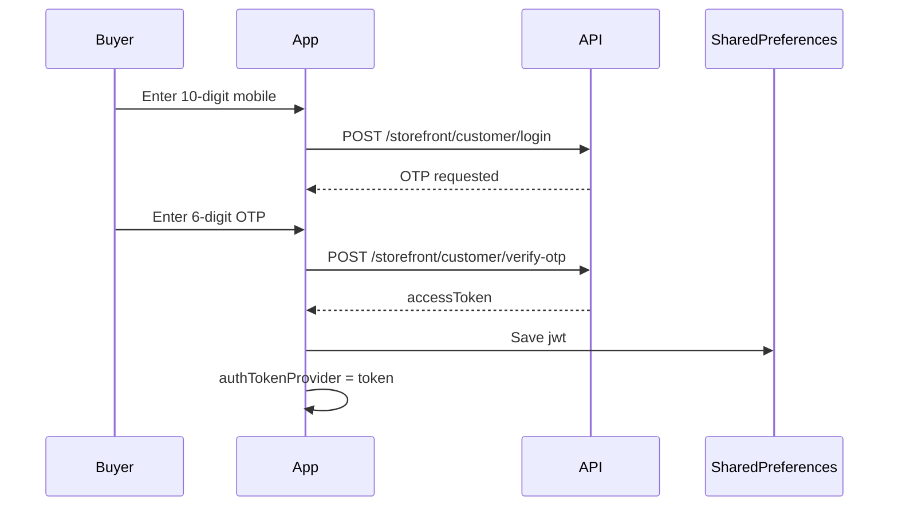

## 2. Complete Feature Scan

Status legend: Complete = usable end-to-end in mobile; Partial = visible but incomplete or demo/local only; Missing = not implemented in Flutter app.

| Feature | Status | Files | Description |
|---|---|---|---|
| Splash | Missing | N/A | No dedicated splash/onboarding screen beyond platform launch. |
| Login | Complete | `features/auth/*` | Mobile OTP login screen and provider. |
| OTP | Complete | `auth_provider.dart`, `auth_screen.dart` | Request and verify OTP, stores JWT. Dev default OTP visible in UI. |
| Registration | Partial | Backend/admin context | Login may create/resolve customer server-side, but no full registration/business profile wizard in mobile. |
| Home | Complete | `features/home/*` | Dynamic grid/list/template home with banners, categories, products. |
| Categories | Complete | `features/categories/category_screen.dart`, `products_provider.dart` | Category rail/grid with product filtering. |
| Products | Complete | `features/products/*` | Product list, search provider, detail screen, add/buy actions. |
| Product variants | Partial | Models support `variantId` in cart; product UI does not expose variant selection. |
| Cart | Complete | `features/cart/*` | Auth cart and guest cart, quantity edits, remove, totals, tax. |
| Wishlist | Partial | `features/wishlist/*` | Local wishlist only; no backend persistence found in Flutter. |
| Orders | Complete | `features/orders/*` | Order list, detail, reorder through cart. |
| Profile | Complete | `features/settings/*` | Profile read, edit name/email, avatar upload, credit/address display. |
| Address | Partial | `customer_profile_provider.dart`, `settings_detail_screens.dart` | Address book UI exists; mobile implementation is local/update-profile oriented and lacks clear dedicated address API integration in provider. |
| Notifications | Partial | `settings_data_provider.dart`, settings details | Inbox fetches `/notifications`; preferences are local toggles. Device push token registration is not in Flutter. |
| Search | Partial | `products_provider.dart`, `products_screen.dart` | Product search query provider exists; no global search. |
| Theme | Complete | `core/theme/*` | Runtime storefront theme and preview template support. |
| Localization | Complete | `core/localization/*`, `assets/locales/storefront/*.json` | Multiple languages and RTL direction support via contract. |
| Payment | Partial | `cart_provider.dart`, `cart_screen.dart` | Payment mode string `PREPAID`/`CREDIT`; no gateway, UPI/card/net banking UI. |
| Coupons | Missing | Backend/admin has coupon pages; Flutter app has no coupon entry/apply flow. |
| GST | Partial | Settings has local GST preference; backend has GST migrations; mobile has no GST verification flow. |
| B2B pricing | Partial | Backend has customer/group/quantity pricing; Flutter displays single `price` or price-on-request only. |
| MOQ | Partial | Backend migrations include MOQ/GST; Flutter quantity steppers do not enforce/display MOQ. |
| Inventory | Partial | Product model displays `stockQuantity`; no warehouse inventory or reservation UI. |
| Vendor | Missing | No vendor/supplier module in Flutter. |
| Admin APIs | Missing in mobile | Admin React/Nest modules exist; Flutter app is buyer-facing. |
| Customer support | Complete | `settings_data_provider.dart`, `HelpSupportScreen` | Fetch support tickets and create ticket. |
| Credit | Complete | `credit_provider.dart`, `credit_screen.dart` | Credit limit/outstanding from customer profile. |
| Reorder | Complete | `orders_provider.dart`, `orders_screen.dart` | Order lines can be added back to cart. |
| App settings | Complete | `user_app_settings_provider.dart`, settings screens | Language, currency, theme, notification, shopping, privacy preferences. |
| Business industry | Partial | `BusinessIndustryScreen`, app config | Displays configured industry; no editable business verification. |

## 3. Screen Audit

| Screen | Route/Entry | Purpose | APIs | UX | UI | Problems / Suggestions |
|---|---|---|---|---:|---:|---|
| Home | Tab 0 | Storefront landing catalog | `/storefront/theme`, `/storefront/app-config`, products/categories | 8 | 8 | Good dynamic layouts. Add merchandising slots, RFQ entry, recently ordered. |
| Cart | Tab 1 | Cart review, address selection, checkout | `/cart`, `/storefront/guest-cart`, `/orders` | 8 | 7 | Good checkout bar. Add coupon, payment selector, MOQ/tier warnings. |
| Orders | Tab 2 | Order history and reorder | `/orders`, `/orders/:id` | 7 | 7 | Add shipment timeline, invoice download, return/cancel actions. |
| Categories | Tab 3 | Browse category products | `/storefront/categories`, `/storefront/products` | 7 | 7 | Add search/filter/sort and category breadcrumbs. |
| Settings/Profile | Tab 4 | Account/settings hub | `/storefront/customer/me` | 8 | 7 | Strong coverage. Separate account, business, billing more clearly. |
| Auth | Drawer/Account | OTP login/logout | `/storefront/customer/login`, `/storefront/customer/verify-otp` | 7 | 6 | Defaults to test mobile/OTP and displays dev helper text. Remove for production. |
| Products | Drawer | Full product list/search | `/storefront/products` | 7 | 7 | Add pagination controls/infinite scroll, filters, sort. |
| Product Detail | Push | Product information and add/buy | cart APIs | 7 | 7 | No variants, MOQ, slabs, stock by warehouse, RFQ. |
| Credit | Drawer | Credit limit/outstanding | `/storefront/customer/me` | 7 | 7 | Add ledger, due dates, payment reminders, credit terms. |
| Wishlist | Drawer | Saved products | local provider | 6 | 7 | Persist server-side and show wishlist actions everywhere. |
| Account Profile | Settings push | Profile, avatar, addresses, credit | `/storefront/customer/me`, PATCH `/storefront/customer/me`, POST avatar | 8 | 7 | Business fields/GST not part of profile edit. |
| Business & Industry | Settings push | Show industry/procurement focus | app config | 6 | 7 | Informational only; add business profile/edit/approval state. |
| Language & Region | Settings push | Language, region, currency | local settings/theme localization | 8 | 7 | Good; ensure every hardcoded string is localized. |
| Notification Preferences | Settings push | Notification toggles/inbox access | `/notifications` for inbox | 6 | 7 | Local toggles not synced to backend/device token. |
| Shopping Preferences | Settings push | Guest cart, repeat orders, default address/payment | local settings/profile | 7 | 7 | Payment preference not tied to real payment methods. |
| Address Book | Settings/cart push | Address management | profile provider/local form | 6 | 7 | Needs explicit create/update/delete/default address API integration. |
| Security & Privacy | Settings push | Session/privacy/reset | local settings/auth | 6 | 7 | No secure token storage, device/session list, account deletion. |
| Appearance | Settings push | Theme mode/text scale | local settings | 8 | 8 | Good mobile settings pattern. |
| Help & Support | Settings push | FAQs, ticket create/list | `/support/tickets` | 8 | 7 | Add attachment/order reference and ticket detail. |
| Legal & Policies | Settings push | Static policies | none | 6 | 6 | Static placeholder policy copy should come from tenant CMS/settings. |
| About App | Settings push | Tenant/config metadata | app config | 7 | 7 | Add version/build number. |

### Weak Screen Redesign Wireframes

Auth production cleanup:

```text
+----------------------------------+
|  Store Logo                      |
|  Sign in to continue             |
|                                  |
|  Country  Phone number           |
|  +91      [__________]           |
|                                  |
|  [ Send OTP ]                    |
|                                  |
|  Trusted by your distributor     |
+----------------------------------+
No prefilled test phone. No dev OTP hint.
```

Product detail enterprise upgrade:

```text
+----------------------------------+
| Product Image                    |
| Name / SKU / Brand               |
| Price: login or slab price       |
| Stock: In stock | MOQ: 10        |
| Variant selector                 |
| Qty stepper with MOQ increments  |
| Tier pricing table               |
| [Add to cart] [Request quote]    |
+----------------------------------+
```

Cart upgrade:

```text
+----------------------------------+
| Delivery Address                 |
| Order Lines                      |
| MOQ / stock warnings             |
| Coupon / promo code              |
| Payment method                   |
| Credit terms / UPI / COD         |
| GST invoice details              |
| [Place Order]                    |
+----------------------------------+
```

## 4. B2B Commerce Checklist

| Module | Implemented? | How It Works | Missing Components | Priority |
|---|---|---|---|---|
| Customer registration | Partial | OTP login and server customer resolution. | Full registration wizard, company fields, approval status. | High |
| GST verification | Missing in mobile | Backend has tenant GST columns/migrations; settings stores GST locally. | GSTIN validation, verification result, legal name, invoice tie-in. | High |
| Business profile | Partial | Industry is shown from app config. | Company profile, trade license, tax data, buyer type. | High |
| Multi-address | Partial | Profile model includes addresses; address book UI exists. | Robust address CRUD API integration and default sync. | High |
| Buyer approval | Missing | No approval state in mobile. | Pending/approved/blocked state and UI gating. | High |
| Categories | Complete | `/storefront/categories`. | Hierarchical filters/breadcrumbs. | Medium |
| Product details | Complete | Product detail screen. | Variant specs, documents, price slabs. | High |
| Variants | Partial | `variantId` supported in cart model only. | Variant selector and stock/pricing by variant. | High |
| MOQ | Partial | Backend migration context. | Display/enforce MOQ in steppers/cart. | High |
| Tier pricing | Partial | Backend catalog pricing modules. | Slab table and calculated line pricing. | High |
| Bulk quantity pricing | Partial | Backend quantity pricing modules. | Bulk entry UI and price breakdown. | High |
| RFQ | Missing | None. | RFQ cart, quote request, sales response. | High |
| Quotes | Missing | None. | Quote list/detail/accept flow. | High |
| Cart | Complete | Auth and guest cart endpoints. | Coupon, payment, MOQ validation. | High |
| Wishlist | Partial | Local only. | Backend sync. | Medium |
| Order placement | Complete | `POST /orders` after sign-in/address. | Payment handoff and confirmation detail. | High |
| Invoice | Missing in mobile | Backend entities/templates exist. | Invoice list/download/share. | High |
| GST invoice | Missing in mobile | Backend tax/invoice context. | GST invoice fields/download. | High |
| Order tracking | Partial | Status visible. | Shipment timeline, courier, ETA. | Medium |
| Returns | Missing | None. | Return request/status. | Medium |
| Reorders | Complete | Adds prior order lines to cart. | Handle unavailable/changed price lines. | Medium |
| COD | Missing/Partial | Payment mode only supports strings. | COD eligibility/select UI. | High |
| UPI/Cards/Net Banking | Missing | No gateway UI. | Razorpay/payment provider integration. | High |
| Credit terms | Partial | Credit display and `CREDIT` payment mode. | Terms, due dates, ledger, limits at checkout. | High |
| Distributor/Retailer pricing | Partial | Backend supports pricing levels. | Mobile pricing display and customer group transparency. | High |
| Sales representative | Missing | None. | Rep contact, assisted orders. | Low |
| Vendor management | Missing | Not buyer app scope. | Admin/vendor module if desired. | Low |
| Inventory | Partial | Product stock displayed. | Warehouse/branch stock and reservation. | Medium |
| Warehouse | Missing in mobile | Preferences include warehouse string. | Warehouse selector and fulfillment rules. | Medium |
| Banner management | Complete via admin/backend | App consumes theme banners. | In-app preview diagnostics. | Medium |
| Coupons/offers | Missing in mobile | Admin pages exist. | Coupon apply/list and offers carousel. | High |
| Push notifications | Partial | Inbox and local toggles. | Device token registration and preference sync. | Medium |
| Admin dashboard | Missing in mobile | Web admin exists. | Not required unless building admin app. | Low |
| Product/user/order admin | Missing in mobile | Web admin/backend exists. | Not mobile buyer scope. | Low |
| Analytics | Missing in mobile | Backend/admin analytics pages exist. | Buyer-facing recommendations only. | Low |

## 5. User Flows

### Actual Main Flow

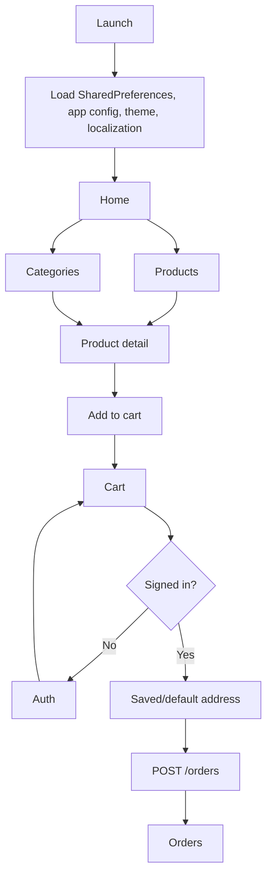

### Account Flow

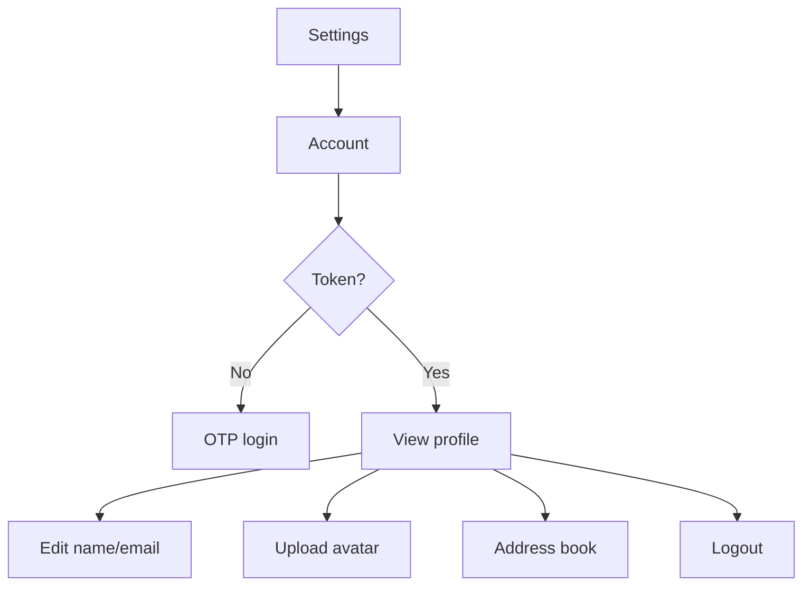

### Reorder Flow

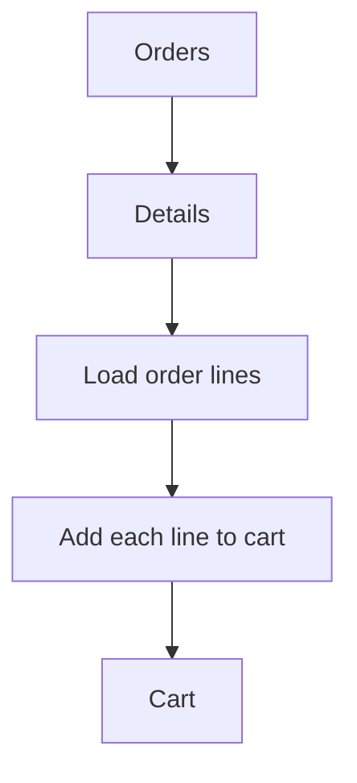

### Settings Flow

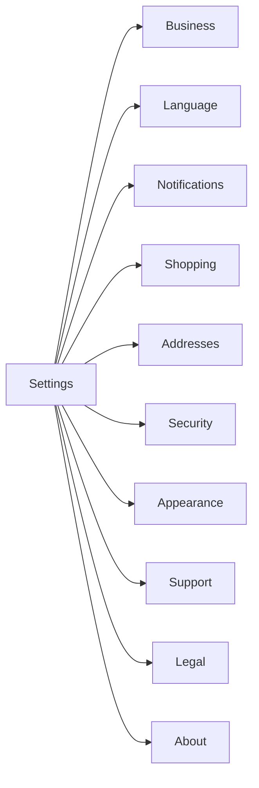

## 6. API Blueprint

Base URL comes from tenant config/default device API base and is normalized in `apiClientProvider`.

| Endpoint | Method | Request | Response Handling | Auth | Used By |
|---|---|---|---|---|---|
| `/storefront/app-config` | GET | Tenant headers | `StorefrontAppConfig` or fallback defaults | Optional | App shell, cart/settings/theme language |
| `/storefront/theme` | GET | `language` query optional | `StorefrontTheme`; fallback empty theme | Optional | Theme provider/home |
| `/storefront/customer/login` | POST | `{ mobile }` | OTP requested; optional auto verify in debug | No | Auth |
| `/storefront/customer/verify-otp` | POST | `{ mobile, code, deviceId }` | extracts access token | No | Auth |
| `/storefront/customer/me` | GET | Bearer token | `CustomerProfile`, credit, addresses | Yes | Profile, credit, cart address |
| `/storefront/customer/me` | PATCH | name/email payload | refresh profile | Yes | Edit profile |
| `/storefront/customer/me/avatar` | POST multipart | `file` | refresh profile | Yes | Avatar upload |
| `/storefront/products` | GET | `page`, `limit`, optional `q` | Product list or demo products | Optional | Home/products/category |
| `/storefront/categories` | GET | none | Category list or demo categories | Optional | Home/category |
| `/storefront/guest-cart` | GET | device id | Guest cart lines | No | Cart |
| `/storefront/guest-cart/items` | POST | product/variant/quantity | Refresh cart | No | Add/update guest cart |
| `/storefront/guest-cart/items/:id` | DELETE | line id | Refresh cart | No | Remove guest cart line |
| `/cart` | GET | Bearer token | Auth cart lines | Yes | Cart |
| `/cart/items` | POST | product/quantity | Refresh cart | Yes | Add auth cart |
| `/cart/items/:id` | PUT | quantity | Refresh cart | Yes | Update auth cart |
| `/cart/items/:id` | DELETE | line id | Refresh cart | Yes | Remove auth cart |
| `/orders` | GET | Bearer token | Order summaries or demo orders | Yes | Orders |
| `/orders` | POST | `{ addressId?, paymentMode }` | Clears cart; navigates orders | Yes | Checkout |
| `/orders/:id` | GET | order id | Order lines for detail/reorder | Yes | Order details |
| `/notifications` | GET | Bearer token | Notification inbox list | Yes | Settings notifications |
| `/support/tickets` | GET | Bearer token | Support ticket list | Yes | Help/support |
| `/support/tickets` | POST | subject/description/priority | Refresh ticket list | Yes | Help/support |

### API Relationship Diagram

```mermaid
flowchart TD
  App[Flutter App] --> Dio[Dio apiClientProvider]
  Dio --> TenantHeaders[X-Tenant-Id / X-Storefront-Host]
  Dio --> DeviceHeader[X-Device-Id]
  Dio --> AuthHeader[Authorization]
  Dio --> Storefront[Storefront APIs]
  Storefront --> Config[/storefront/app-config]
  Storefront --> Theme[/storefront/theme]
  Storefront --> Catalog[/storefront/products + categories]
  Storefront --> Auth[/storefront/customer login/verify/me]
  Storefront --> Cart[/cart or guest-cart]
  Storefront --> Orders[/orders]
  Storefront --> Support[/support/tickets]
```

## 7. Design System

### Current System

| Token/Component | Current Implementation |
|---|---|
| Color | Runtime `ColorScheme.fromSeed` using `StorefrontTheme.branding`; fallback blue/teal. |
| Typography | Roboto font, Material text theme overrides in places. |
| Radius | Mixed: app shell bottom nav 26, cards often 8, product/home cards 8-12, auth button 7, settings profile 22. |
| Elevation | Mostly low/no elevation; bottom nav uses shadow. |
| Buttons | Filled, outlined, segmented, custom auth button. |
| Cards | Material `Card` and custom containers. |
| Inputs | Underline auth fields, outlined support/address fields. |
| Navigation | Floating pill bottom nav, drawer, AppBar back buttons. |
| Icons | Material icons throughout. |
| Images | Asset/network/SVG fallbacks; demo product assets. |
| Localization | Many strings localized through translator, but several settings/detail strings are hardcoded English. |

### Consistency Report

| Area | Score | Notes |
|---|---:|---|
| Color consistency | 8/10 | Good tenant-driven seed colors. Hardcoded reds/pinks appear in template sections. |
| Typography | 7/10 | Roboto consistent; font weights are heavy in many places. |
| Radius | 6/10 | Mix of 7, 8, 12, 14, 16, 22, 26. Enterprise UI should standardize. |
| Navigation | 7/10 | Clear tabs/drawer but no named routes; detail navigation is scattered. |
| Localization | 7/10 | Strong infrastructure; many hardcoded settings strings remain. |
| Empty/error/loading states | 8/10 | Most screens include states and retry. |
| Accessibility | 6/10 | Text scaling supported; contrast generally okay; custom auth gesture button should be semantic button. |

### Recommended Design Rules

| Rule | Recommendation |
|---|---|
| Radius | Standardize to 8 for cards/buttons, 12 for media, 24 only for bottom nav. |
| Commerce density | Use compact cards and tables for B2B buying efficiency. |
| Price display | Add structured price blocks: base, slab, tax, MOQ, credit eligibility. |
| Product cards | Show SKU, pack/unit, MOQ, stock, quick quantity. |
| Checkout | Convert cart bottom area into clear order summary + payment section. |
| Localization | Move all hardcoded user-visible strings into dictionaries/contracts. |

## 8. Performance Audit

| Area | Observation | Risk | Recommendation |
|---|---|---|---|
| Rebuilds | App shell watches many providers at top level. | Medium | Split shell sections into smaller consumer widgets. |
| Products | `productsProvider` fetches page/limit but no visible infinite pagination. | Medium | Implement paging/infinite scroll and cache pages. |
| Images | Uses `Image.network`/asset and SVG; no explicit cache sizing. | Medium | Add constrained `cacheWidth/cacheHeight` for large product images where possible. |
| Cart updates | Optimistic updates for quantity; refreshes after API. | Low | Keep; add debounce for rapid quantity taps. |
| Theme fetch | Fallbacks gracefully; dynamic template rendering. | Low | Cache theme with version/id and refresh only when needed. |
| Localization | Loads bundled JSON via rootBundle. | Low | Good. |
| Memory | No obvious heavy controllers except settings forms. | Low | Dispose is mostly handled. |
| Network | Repeated provider fetches can happen on invalidation. | Medium | Add repository layer/cache and typed responses. |

Optimization score: 70/100

## 9. Security Audit

| Area | Finding | Risk |
|---|---|---|
| Token storage | JWT is stored in `SharedPreferences` under `jwt`. | High |
| Secure storage | No `flutter_secure_storage` or platform keystore use found. | High |
| Debug OTP | Auth UI pre-fills `9999999999` and `000000`; helper text mentions dev OTP. | High for production |
| Headers | Tenant/device/auth headers are consistently applied. | Low |
| 401 handling | Customer profile clears JWT on 401; other providers vary. | Medium |
| Input validation | Mobile/OTP validation exists; support/profile basic validation. | Medium |
| Sensitive logs | Debug mode logs API URLs, tenant headers, bearer presence but not token value. | Low/Medium |
| Authorization | Depends on backend JWT/guards; mobile only gates UI. | Medium |
| Device identity | Device id in SharedPreferences is not secret. | Medium |
| Error messages | Some raw errors are displayed to users. | Medium |

Security score: 56/100

Top fixes:

1. Move JWT storage to secure storage.
2. Remove dev phone/OTP defaults and helper copy from production builds.
3. Standardize auth expiry handling across all API providers.
4. Add request/response typed error mapping and avoid raw exception display.
5. Sync notification/privacy preferences to backend if they control real delivery.

## 10. What Is Already Built

Progress dashboard:

```text
Mobile buyer storefront        [########--] 80%
Catalog and products           [#######---] 70%
Cart and checkout              [#######---] 72%
Orders and reorder             [#######---] 70%
Profile and address            [######----] 62%
Theme/localization             [########--] 82%
Enterprise B2B procurement     [#####-----] 49%
Payments and invoices          [###-------] 30%
Admin/vendor mobile            [----------] 0%
```

Completed:

| Completed Area | Evidence |
|---|---|
| OTP login/logout | `auth_provider.dart`, `auth_screen.dart` |
| Tenant-aware Dio client | `api_client.dart` |
| Theme runtime | `theme_service.dart`, `theme_provider.dart`, `theme_model.dart` |
| Localization | `language_provider.dart`, dictionaries |
| Home layouts | grid/list/template/fast-order layout files |
| Products/categories | providers and screens |
| Cart/totals/checkout | cart provider/screen |
| Orders/reorder | orders provider/screen |
| Profile/credit | customer profile and credit providers |
| Support tickets | settings support service |

Partial:

| Partial Area | Gap |
|---|---|
| Search | Product-only, no filters/sort/global search. |
| Wishlist | Local only. |
| Address book | UI exists; API integration appears incomplete for full CRUD. |
| Notifications | Inbox exists; push token/preferences not fully wired in Flutter. |
| Payments | Payment mode is a string; no real gateway UI. |
| B2B pricing/MOQ/GST | Backend hints exist; mobile display/enforcement missing. |

Missing:

| Missing Area | Notes |
|---|---|
| RFQ/quotes | No mobile feature. |
| GST verification | No mobile verification flow. |
| GST invoice download | No mobile invoice screen. |
| Coupons/offers apply | No mobile coupon flow. |
| Returns/cancellations | No mobile flow. |
| Admin mobile | Out of buyer app scope. |

## 11. What Should Be Built Next

### Phase 1: Critical Production Hardening

| Task | Objective | Files Affected | Dependencies | Complexity | Priority |
|---|---|---|---|---|---|
| Secure token storage | Store JWT safely | `auth_provider.dart`, `main.dart`, new secure storage service | `flutter_secure_storage` | Medium | P0 |
| Remove dev auth defaults | Production-safe login | `auth_screen.dart`, build flags | BuildConfig env | Low | P0 |
| Address API integration | Real address CRUD/default | `customer_profile_provider.dart`, `settings_detail_screens.dart`, backend DTO alignment | Backend address endpoints | Medium | P0 |
| Checkout validation | Prevent invalid B2B orders | `cart_screen.dart`, `cart_provider.dart` | MOQ/tax/pricing API fields | Medium | P0 |
| Error normalization | Friendly secure errors | `dio_errors.dart`, providers | Backend error contract | Low | P1 |

### Phase 2: Commerce Completion

| Task | Objective | Files Affected | Dependencies | Complexity | Priority |
|---|---|---|---|---|---|
| Product filters/sort/pagination | Scalable catalog | `products_provider.dart`, products/category screens | API query support | Medium | P1 |
| Variants and MOQ UI | B2B product selection | `Product`, product detail/card/cart | Backend variant payload | High | P1 |
| Tier pricing display | Show customer/group/slab prices | product provider/detail/cart | Catalog pricing API | High | P1 |
| Coupon apply | Offers and discounts | cart provider/screen | Coupon API | Medium | P1 |
| Payment selector | COD/UPI/cards/net banking/credit | cart/checkout screens | Payment gateway/backend | High | P1 |

### Phase 3: Business Features

| Task | Objective | Files Affected | Dependencies | Complexity | Priority |
|---|---|---|---|---|---|
| Business profile + GST | Verify buyer identity | settings/auth/profile | GST service/backend endpoints | High | P1 |
| RFQ and quotes | Support negotiated purchasing | new `features/quotes` | Backend quote module | High | P2 |
| Invoice center | GST invoice download/share | orders/profile screens | Invoice API | Medium | P2 |
| Credit ledger | Show dues/transactions | credit screen/provider | Credit ledger API | Medium | P2 |
| Order tracking/returns | Post-order operations | orders screen/provider | Shipment/returns APIs | High | P2 |

### Phase 4: Enterprise

| Task | Objective | Files Affected | Dependencies | Complexity | Priority |
|---|---|---|---|---|---|
| Sales rep assisted ordering | Human-assisted B2B sales | account/support/cart | Staff/customer assignment API | Medium | P3 |
| Warehouse selection | Fulfillment optimization | cart/settings/product | Warehouse inventory APIs | Medium | P3 |
| Push notification registration | Real push delivery | app bootstrap/settings | Firebase/APNs/FCM config | Medium | P2 |
| Analytics events | Measure commerce funnel | app shell/features | Analytics endpoint | Medium | P3 |
| Admin companion app | Mobile operations app | separate app/module | Admin permissions and APIs | Very High | P4 |

## 12. Image Blueprint

The blueprint uses Mermaid and wireframe blocks so it remains pure Markdown and portable.

### App Architecture Diagram

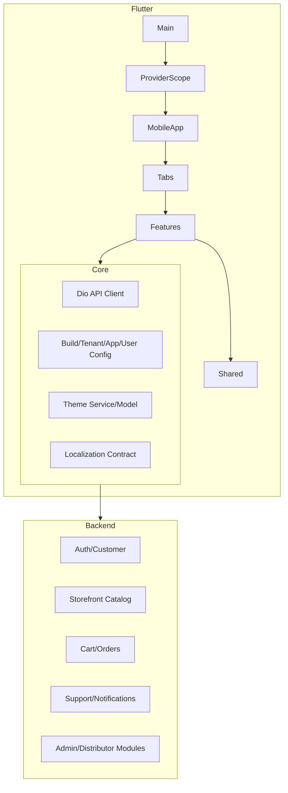

### Navigation Map

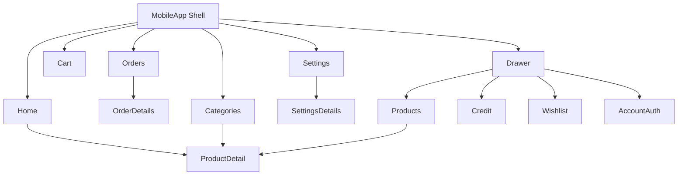

### Database Relationship Diagram, Inferred From Backend Entity Names

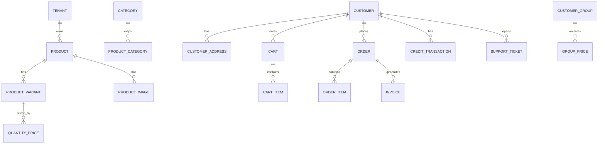

### B2B Commerce Workflow

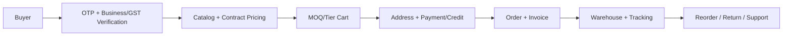

### Admin Workflow Context

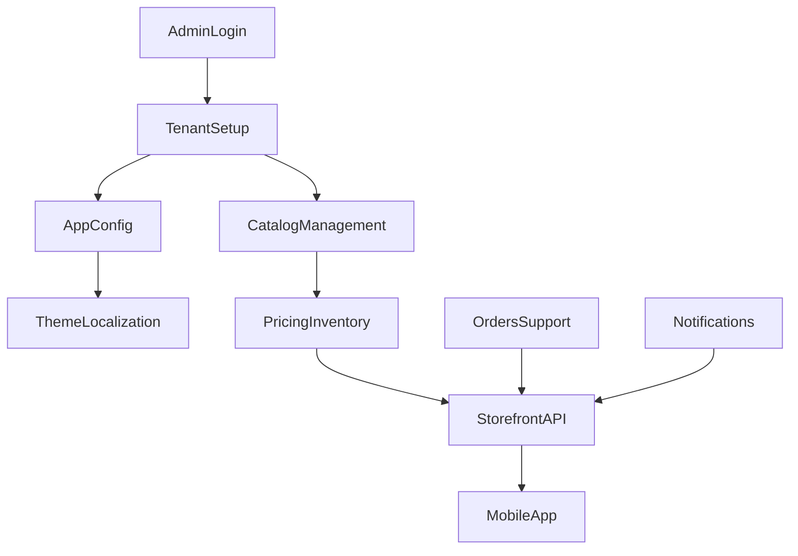

## Final Audit Notes

The Flutter app is a solid buyer-facing commerce shell with real backend integration points and resilient demo fallbacks. Its architecture is understandable and modular enough for a new developer to extend. The main technical debt is not a lack of screens; it is that several B2B concepts exist as backend/admin capability or local preferences but are not yet exposed as trustworthy mobile workflows.

The next highest-value work is production authentication hardening, full address/profile/business verification, B2B product buying rules, payment/invoice completion, and richer order operations.
